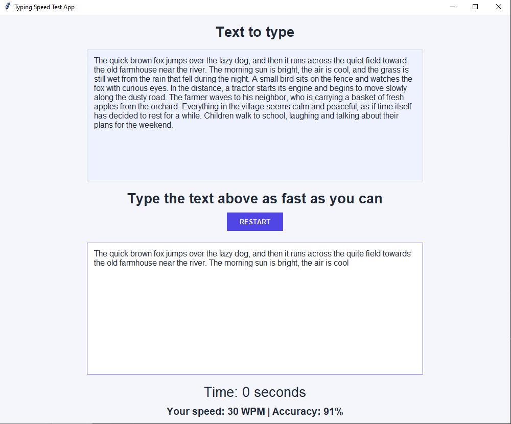

# Typing Speed Test App

A desktop typing speed test built with Python and Tkinter, created as part of Angela Yu's *100 Days of Code* bootcamp (Day 86).

Type the displayed text as fast and as accurately as you can. You have 60 seconds, and when time runs out the app shows your speed (WPM) and your accuracy.

## Features

- Random sample text picked from a small collection on every start/restart
- 60-second countdown that starts automatically when you press your first key
- Typing area locks when time is up
- Results: words per minute (WPM) and accuracy percentage
- RESTART button: resets the timer, clears your input and loads a new text
- Clean, modern look with a custom color palette

## Requirements

- Python 3.8 or newer
- Tkinter (included with the standard Python installer on Windows and macOS; on some Linux distributions install it with `sudo apt install python3-tk`)

No external packages are needed, so there is no `requirements.txt`.

## How to run

```bash
git clone <your-repo-url>
cd <your-repo-folder>
python main.py
```

## How it works

- **Timer:** `window.after(1000, ...)` calls the update function once per second. `after_cancel` stops it when you restart.
- **Start trigger:** the timer begins on the first `<Key>` event in the typing box.
- **Scoring:** the original text and your text are split into words. Using `zip`, the app compares them position by position (1st word with 1st word, 2nd with 2nd, and so on) and counts how many match exactly. Punctuation counts, so `river.` and `river` are different words.
  - **WPM** = number of correctly typed words (the test lasts exactly 60 seconds)
  - **Accuracy** = correct words / total typed words x 100

## Screenshot



## Possible improvements

- Highlight mistakes live while typing
- Let the user choose the test duration (30 / 60 / 120 seconds)
- Save a personal best score to a file

## Credits

Project idea from [100 Days of Code: The Complete Python Pro Bootcamp](https://www.udemy.com/course/100-days-of-code/) by Dr. Angela Yu.