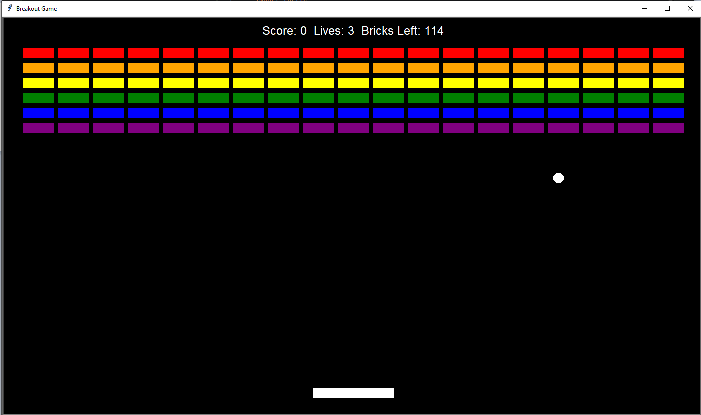

# 🕹️ Breakout Game in Python

A classic **Breakout** arcade game built using Python's Object-Oriented Programming (OOP) principles and the `turtle` graphics library. This project was developed as part of Angela Yu's 100 Days of Code Python Bootcamp.



## 🚀 Features
- **Object-Oriented Architecture:** Modular codebase separated into classes (`Paddle`, `Ball`, `Bricks`, and `Scoreboard`).
- **Smooth Gameplay Loop:** Manual frame control using `turtle.tracer(0)` and `update()` for smooth, flicker-free rendering.
- **Dynamic Difficulty:** The ball's speed increases progressively every 5 broken bricks.
- **Pause & Resume:** Press `P` at any time to pause or unpause the game.
- **Instant Restart:** Press `R` after a Game Over or Victory to restart without closing the window.

---

## 🎮 Controls

| Key | Action |
| :--- | :--- |
| `Left Arrow` | Move Paddle Left |
| `Right Arrow` | Move Paddle Right |
| `P` | Pause / Unpause Game |
| `R` | Restart Game (when Game Over / Won) |

---

## 🛠️ Built With
- **Python 3**
- **Turtle Graphics** (Standard Library)
- **Time** (Standard Library)

---

## 🏃‍♂️ How to Run

1. Make sure you have Python installed on your system.
2. Clone this repository or download the files.
3. Open a terminal inside the `Breakout Game` directory and run:
   ```bash
   python main.py